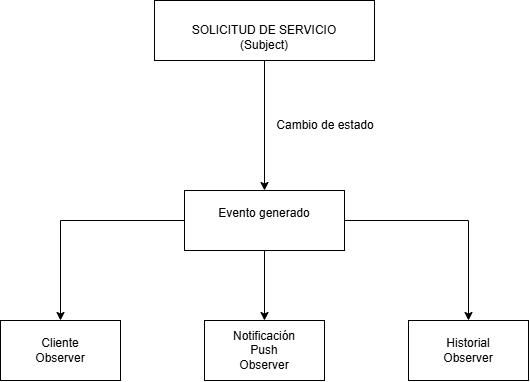

# Selección del patrón de diseño

## Patrón de diseño seleccionado: Observer (Observador)

Para el desarrollo de Fixora se seleccionó el patrón de diseño Observer (Observador), debido a que la plataforma requiere gestionar diferentes eventos y cambios de estado que deben ser comunicados automáticamente a los usuarios y componentes involucrados en un servicio.

Fixora maneja un flujo dinámico en el que una solicitud puede cambiar de estado desde su creación hasta la finalización del servicio. Por ejemplo, una solicitud puede pasar por los estados de pendiente, aceptada, en camino, llegado, finalizada o cancelada. Cada uno de estos cambios puede generar diferentes acciones dentro del sistema.

El patrón Observer permite que un objeto principal, denominado Subject, notifique automáticamente a los objetos interesados, denominados Observers, cuando ocurre un cambio. De esta manera, la lógica principal de la solicitud no necesita conocer directamente todos los componentes que deben reaccionar ante dicho cambio.

En Fixora, el patrón puede aplicarse de la siguiente manera:

Por ejemplo, cuando un prestador acepta una solicitud de servicio, el sistema cambia el estado de la solicitud a “Aceptada”. Este cambio genera un evento que puede notificar automáticamente al cliente mediante una notificación push, actualizar la información mostrada en su aplicación y registrar el cambio en el historial del servicio.

De manera similar, cuando el prestador inicia su recorrido, llega al domicilio, cancela el servicio o finaliza la atención, el cambio de estado puede generar diferentes acciones sin modificar directamente la lógica principal de la solicitud.

## Aplicación del patrón en Fixora

El patrón Observer podrá utilizarse principalmente en los siguientes procesos:

- **Solicitudes de servicio:** notificar los cambios de estado de una solicitud.
- **Notificaciones push:** informar al cliente o prestador sobre eventos importantes.
- **Seguimiento del servicio:** actualizar la información relacionada con el recorrido del prestador.
- **Temporizador de aceptación:** informar cuando una solicitud ha superado el límite de respuesta establecido.
- **Finalización del servicio:** habilitar acciones como calificación, reseña y reporte.
- **Reportes y disputas:** notificar cambios en el estado de una incidencia.
- **Historial:** registrar automáticamente determinados eventos relevantes del servicio.

## Justificación de la elección

La elección del patrón Observer se debe a que Fixora depende de la comunicación de eventos en tiempo real entre diferentes componentes del sistema. Al utilizar este patrón, es posible mantener separada la lógica encargada de administrar las solicitudes de los componentes responsables de enviar notificaciones, actualizar información y registrar eventos.

Además, esta estructura facilita la incorporación de nuevas funcionalidades en el futuro. Por ejemplo, si posteriormente se requiere agregar notificaciones por correo electrónico, mensajes internos o nuevos tipos de alertas, estos componentes pueden incorporarse como nuevos observadores sin modificar significativamente la lógica principal de las solicitudes.

Por lo tanto, el patrón Observer proporciona una estructura adecuada para manejar los cambios de estado, las notificaciones y los eventos que forman parte del flujo principal de servicios de Fixora.
