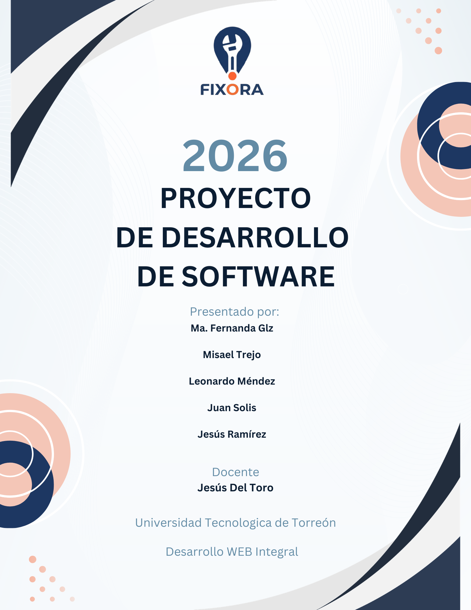

# Unidad 1 · Anteproyecto

**Proyecto de Desarrollo de Software · 2026**

| Dato | Valor |
| --- | --- |
| Universidad | Universidad Tecnológica de Torreón |
| Asignatura | Desarrollo Web Integral |
| Docente | Jesús Del Toro |

**Presentado por:**

- Ma. Fernanda Glz
- Misael Trejo
- Leonardo Méndez
- Juan Solis
- Jesús Ramírez

## Contenido

1. [Problemática](01-problematica.md)
2. [Justificación](02-justificacion.md)
3. [Objetivos](03-objetivos.md)
4. [Alcances](04-alcances.md)
5. [Requisitos funcionales](05-requisitos-funcionales.md)
6. [Requisitos no funcionales](06-requisitos-no-funcionales.md)
7. [Limitaciones](07-limitaciones.md)
8. [MVP (Producto Mínimo Viable)](08-mvp.md)
9. [Análisis de riesgos](09-analisis-de-riesgos.md)
10. [Metodología y roles del equipo](10-metodologia-y-roles.md)
11. [Separación del proyecto en tareas](11-tareas.md)
12. [Estructura web y tecnologías](12-estructura-y-tecnologias.md)
13. [Patrón de diseño](13-patron-de-diseno.md)
14. [Wireframes](14-wireframes.md)
15. [Lluvia de ideas](15-lluvia-de-ideas.md)
